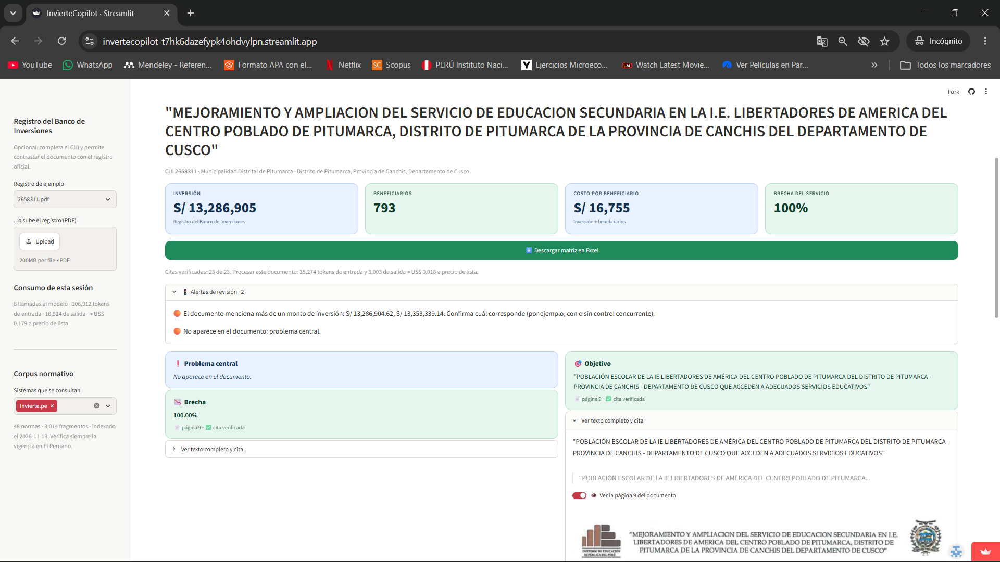
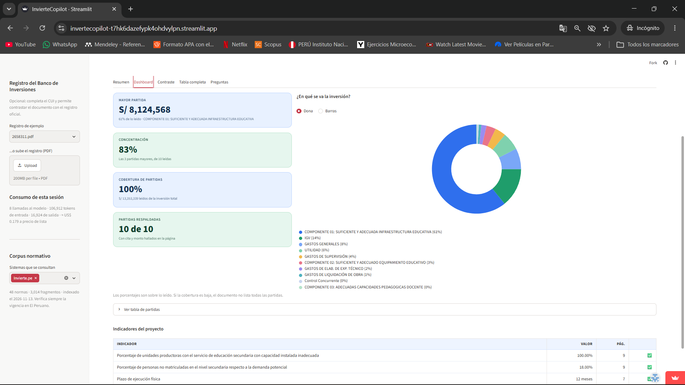
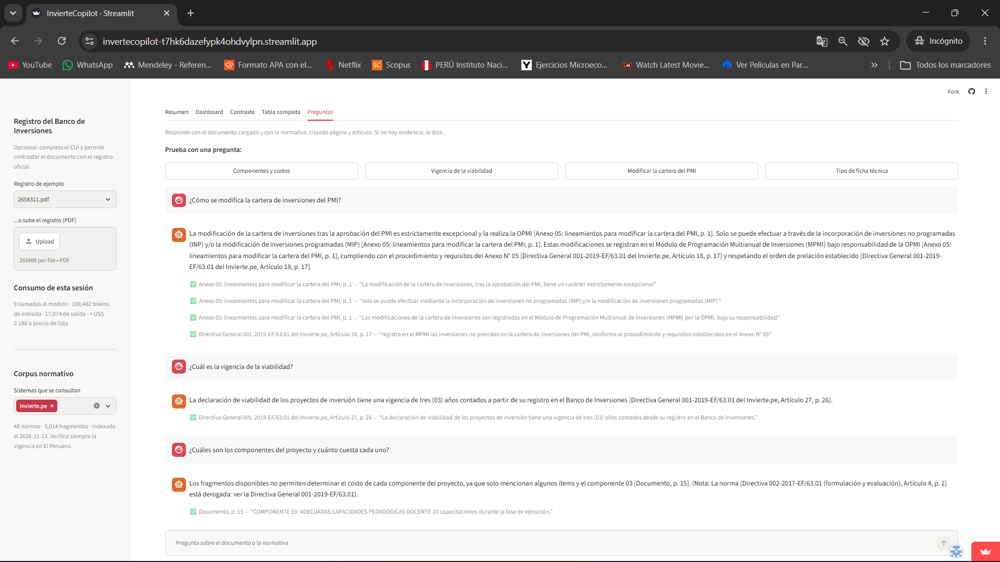

# InvierteCopilot

> **One-liner:** Hacemos un asistente para consultores de inversión pública que convierte una ficha técnica o resumen ejecutivo de Invierte.pe en una matriz con cada dato citado (página y fragmento verificados por código), la contrasta con el Banco de Inversiones y responde preguntas con la normativa, mediante OCR, LLMs con salida estructurada y RAG.

- **Demo en vivo:** https://invertecopilot-t7hk6dazefypk4ohdvylpn.streamlit.app/
- **Video de respaldo (60–90 s):** https://drive.google.com/file/d/1kLi0KkGD-1PV85SLzlZh4NrV7iy7Qkhq/view?usp=sharing

---

## 1. One-liner
Hacemos **un extractor con trazabilidad y contraste normativo** para **consultores y analistas de proyectos de inversión pública** mediante **OCR + LLM con salida estructurada + RAG sobre la normativa de Invierte.pe**.

## 2. Founder
**Patricia Castro Hilario** — estudiante de Economía en la Universidad del Pacífico.

- **Por qué yo:** `[COMPLETAR con tus palabras: en tu consultoría de inversión pública armaste matrices a mano desde documentos técnicos y normas (por ejemplo, el marco normativo de Invierte.pe y su cruce con presupuesto, planeamiento y contrataciones). Qué documentos revisaste, cuántos, qué te frustró.]`
- Ya conocía el flujo real: Banco de Inversiones, fichas técnicas escaneadas, normas que cambian y matrices en Excel como entregable.

## 3. Problema
- **Quién lo sufre:** consultores y analistas que revisan fichas técnicas y estudios de preinversión y arman matrices en Excel para sus informes.
- **Cómo se resuelve hoy:** se lee el documento, se copian los datos a Excel y se busca la norma en el SPIJ. Quien ya usa IA (Claude, ChatGPT, NotebookLM, Perplexity) la usa para estructurar, pero **desconfía del resultado y lo contrasta con la fuente original**.
- **Dónde duele:** (1) los documentos son PDF largos, a veces escaneados; (2) a las fichas les faltan datos y hay que completarlos con otras bases; (3) con la normativa, lo difícil es saber cuál es la **versión vigente**.
- **Costo (caso de ejemplo con mis tiempos, no un dato de mercado):** por documento, leer la ficha me toma ≈ 2 h, revisar la normativa aplicable y su vigencia entre 2 y 3 h (es lo más tedioso: unas normas complementan a otras) y armar la matriz que piden entre 1 y 1.5 h. Son **5 a 6.5 horas por documento**. A mi tarifa (S/ 1,230 al mes por 30 horas semanales ≈ S/ 9.5 por hora) cada documento cuesta **S/ 47 a 61**. Reviso 2 o 3 documentos al mes (≈ S/ 95 a 185); un equipo de 5 a 8 personas en una consultora o gobierno regional, 10 a 24 documentos (≈ S/ 470 a 1,480 al mes). Supuesto: la normativa se revisa con cada documento. Con 3 conversaciones no puedo estimar el costo promedio del sector.
- **Evidencia (3 conversaciones, notas literales en [`docs/research/`](docs/research/)):**
  - [Entrevista 1](docs/research/entrevista-01.md): gerenta de proyectos. Ya usa IA para armar matrices con citas, pero insiste en contrastar con la fuente; su reto con la normativa es la vigencia.
  - [Entrevista 2](docs/research/entrevista-02.md): analista de proyectos. Su destino final es una matriz en Excel; busca normas en el SPIJ; su organización paga ChatGPT (USD 100 al mes).
  - [Entrevista 3](docs/research/entrevista-03.md): `[PENDIENTE]`

## 4. Solución e insight
**Qué hace:** subes la ficha técnica o el resumen ejecutivo (PDF, incluso escaneado) y obtienes:

1. **Matriz estructurada** (nombre, CUI, entidad, problema, brecha, objetivo, población, componentes, costos, indicadores…) con **página y fragmento literal** de cada dato.
2. **Dashboard** con inversión, costo por beneficiario, composición de la inversión y análisis de partidas.
3. **Contraste con el Banco de Inversiones** (registro oficial): marca diferencias de nombre, entidad y monto.
4. **Alertas de revisión** que dicen qué debe mirar una persona antes de firmar.
5. **Chat** que responde solo con el documento y con la normativa del corpus, citando artículo y página, y **se abstiene** cuando no encuentra respaldo.
6. **Descarga en Excel** (Resumen, Matriz, Costos, Indicadores, Contraste), con página y cita por dato.

**Insight:** el cuello de botella no es leer, es **confiar**. Un chat genérico ya resume, pero el consultor debe volver al PDF a comprobar cada cifra. InvierteCopilot no es un resumidor: **el LLM lee, el código verifica y calcula**.

- Cada cita se comprueba por código: el fragmento debe existir en la página indicada. ✅ significa «fragmento hallado», no «valor correcto»; por eso hay un visor que muestra la página (con el fragmento resaltado en PDFs digitales).
- Las cifras del dashboard (costo por beneficiario, brecha, cobertura de partidas) las calcula código determinista, no el modelo.

## 5. Why now
- Los LLM ya devuelven **salida estructurada** que se valida con esquemas (pydantic), y su costo por documento bajó a centavos de dólar.
- El **OCR de código abierto** (PaddleOCR, Tesseract) permite leer fichas escaneadas sin servicios de pago.
- El **Estado ya publica** fichas y normas en línea, pero en PDF; el RAG sobre una normativa acotada es viable hoy con un índice léxico sencillo y citas verificables.

## 6. Demo
- **URL pública:** https://invertecopilot-t7hk6dazefypk4ohdvylpn.streamlit.app/
- **Correr en local:**
  ```bash
  python -m venv .venv
  .venv\Scripts\activate            # Windows (PowerShell)
  pip install -r requirements.txt
  copy .env.example .env            # y completa LLM_API_KEY
  streamlit run app.py
  ```
  Para OCR local se necesita Tesseract con idioma español (`packages.txt` lo declara para despliegue en Streamlit Cloud).
- **Capturas**
  
  
  

- **Arquitectura:** [`docs/arquitectura.md`](docs/arquitectura.md)
- **Modelos y por qué:**
  - **Gemini 3.5 Flash** para extraer la matriz (lee documentos largos y devuelve JSON); **Flash-Lite** como modelo de respaldo si el principal falla o está saturado. Se reintentan los errores transitorios (503, 429, cortes de conexión) antes de pasar al respaldo.
  - **BM25 propio** (no embeddings) para recuperar normas: el corpus es pequeño, el vocabulario legal es muy literal y así cada resultado es explicable y auditable. Límite asumido: no entiende sinónimos.

### Evaluación (honesta)
- **Citas:** en el documento de prueba (Pitumarca, escaneado, 47 páginas) se verificaron **27 de 27 citas**.
- **Recuperación de normas** (`eval/preguntas.csv`): **12 de 13** preguntas con la norma esperada entre los resultados y **4 de 4** preguntas fuera de alcance con abstención correcta. Ojo: **el conjunto lo escribí yo**, así que puede ser optimista.
- Se corre con `python -m src.rag eval`.

## 7. Modelo de negocio
- **Quién paga:** consultoras y equipos técnicos de inversión pública (gobiernos regionales y locales, UF/UEI, OPMI, firmas que preparan o evalúan proyectos). En mi caso, 2 o 3 documentos al mes por persona; en una consultora o gobierno regional trabajan 5 a 8 personas con ese ritmo.
- **Precio (hipótesis por validar, no probado):** plan por equipo de **S/ 299 al mes hasta 5 usuarios**. Con mis tiempos, el problema le cuesta a un equipo de ese tamaño entre S/ 470 y 1,480 al mes a una tarifa junior de S/ 9.5 por hora (ver sección 3), de modo que el plan equivale a entre el 20% y el 60% de ese costo. Referencia real de una entrevista: una organización ya paga USD 100 al mes por una herramienta de IA genérica (no precisó si es por persona o en total).
- **Costo por documento** (tokens medidos con el documento de prueba: **31,993 de entrada y 6,342 de salida**, incluido el razonamiento del modelo):
  - **Gemini 3.5 Flash-Lite: ≈ US$ 0.025.** Precio oficial verificado en ai.google.dev el 14/11/2026: US$ 0.30 por millón de entrada y US$ 2.50 por millón de salida. Los tokens se midieron con Flash, así que con Flash-Lite la cifra puede variar un poco.
  - **Gemini 3.5 Flash (modelo de la extracción): ≈ US$ 0.105** a US$ 1.50 y US$ 9.00 por millón, precios de lista tomados de fuentes que citan a Google; no pude confirmarlos en la página oficial porque Google marcó este modelo como obsoleto y lo redirige a Gemini 3.6 Flash. El costo real podría ser menor.
  - Hoy mi clave está en el **nivel gratuito**, así que no pago nada; estas cifras son lo que costaría a precio de lista. Detalle en [`docs/costos.md`](docs/costos.md).
- **Margen (ejemplo):** un equipo con 10 a 24 documentos al mes cuesta ≈ US$ 0.25 a 2.5 de extracción (según el modelo), frente a un plan de S/ 299. No incluye soporte, servidor ni las preguntas del chat, que aún no he medido.
- La app muestra el consumo real de la sesión en la barra lateral.

## 8. Herramientas del curso
| Herramienta | Sesión | Dónde se usa | Archivo |
|---|---|---|---|
| Document AI con OCR (PaddleOCR / Tesseract) | 10 | Lee PDFs escaneados, con caché por contenido y punto de control por página | `src/ocr.py` |
| LLM con salidas estructuradas | 08 | Matriz con esquema validado y citas | `src/extract.py`, `src/llm.py` |
| RAG | 08 | Chat sobre el documento y la normativa, con abstención | `src/rag.py` |
| Visualización y dashboards (Streamlit, pandas, altair) | 05 | Interfaz, panel de partidas y exportación a Excel | `app.py`, `src/dashboard.py`, `src/exportar.py` |
| Evaluación | 12 | Conjunto de preguntas para medir la recuperación de normas y la abstención | `eval/preguntas.csv`, `python -m src.rag eval` |

## 9. Qué hizo el agente
Trabajé con Claude como asistente de programación. **Lo que generó el agente:** la estructura del código, el parser del registro del Banco de Inversiones, el índice BM25, el diseño del dashboard y las pruebas de humo.

**Lo que hice yo:**
- Definí el problema y el usuario: hice y transcribí las conversaciones con usuarios.
- Reuní el corpus normativo y el documento de prueba, y marqué qué normas están derogadas.
- Probé la app con documentos reales y detecté los fallos: montos mal leídos por OCR, normas derogadas que salían primero, preguntas fuera de alcance, cobertura de partidas de 198% por subtotales contados dos veces, gráficos cortados.
- Decidí el diseño: cifras en recuadros, dona frente a barras, y que el panel aportara algo que un buscador de PDF no da (los subtotales y la cobertura de partidas salieron de ahí).
- Instalé y corrí el proyecto en dos computadoras y subí los cambios al repositorio en varios días.

**Limitación de mi aporte:** casi todo el código lo escribió el agente; yo lo probé y lo validé, y `[COMPLETAR: qué partes puedo explicar sin ayuda]`.

## Limitaciones
- **El corpus es una foto:** se indexó el 13/11/2026 y no se actualiza solo. **La vigencia debe verificarse siempre en El Peruano / SPIJ.** El chat lo avisa.
- **Recuperación léxica:** BM25 no entiende sinónimos; una pregunta con otras palabras puede no encontrar la norma (por eso se abstiene en vez de inventar).
- **Un «✅» no prueba que el valor sea correcto:** solo que el fragmento existe en la página. Los PDFs escaneados no se pueden resaltar.
- **El documento puede no listar todas las partidas** o repetir subtotales; el dashboard muestra la cobertura para que se note.
- **Evaluación pequeña** y escrita por la autora; solo 3 conversaciones con usuarios.
- **Privacidad:** en el nivel gratuito de Gemini, Google puede usar lo que se envía para mejorar sus productos; en el nivel pagado no. Para documentos de clientes o de gobiernos hay que usar el nivel pagado.
- No reemplaza la revisión de un profesional: ordena y acelera, no firma.

## Estructura del repo
```
app.py                 interfaz Streamlit
src/ocr.py             PDF → texto (con OCR y caché)
src/extract.py         matriz con esquema, citas y verificación
src/llm.py             cliente del modelo, reintentos, respaldo y consumo
src/parse_bi.py        registro del Banco de Inversiones
src/contraste.py       documento vs registro
src/dashboard.py       cifras calculadas por código
src/alertas.py         alertas de revisión
src/rag.py             índice BM25 y respuestas con citas
src/visor.py           página del PDF con el fragmento resaltado
src/exportar.py        matriz a Excel
data/corpus/manifest.csv   normas del corpus (PDF no incluidos en el repo)
data/index/            índice ya construido
data/demo/             documentos de ejemplo
eval/preguntas.csv     preguntas de evaluación
docs/research/         notas de entrevistas
```
