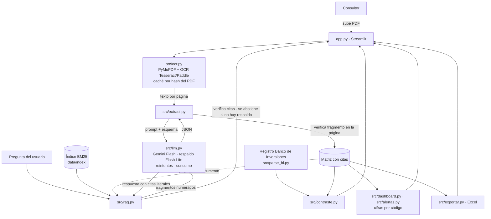

# Arquitectura

## Principios
1. **El modelo lee, el código verifica y calcula.** Toda cita se comprueba contra el texto de la página; todo monto derivado lo calcula código.
2. **Abstención antes que invención.** Si la cobertura de la consulta es baja, el chat dice que no encontró respaldo.
3. **Caché.** El OCR se guarda por contenido del PDF: se paga una vez por documento.
4. **Corpus normativo versionado.** Cada norma tiene sistema, tipo y si está derogada (`data/corpus/manifest.csv`); las derogadas pesan menos al ordenar.
